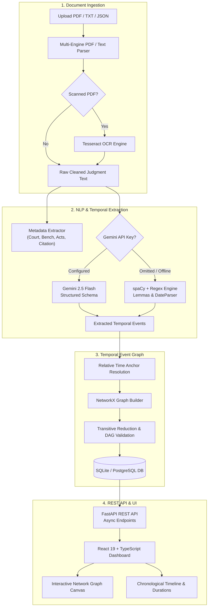
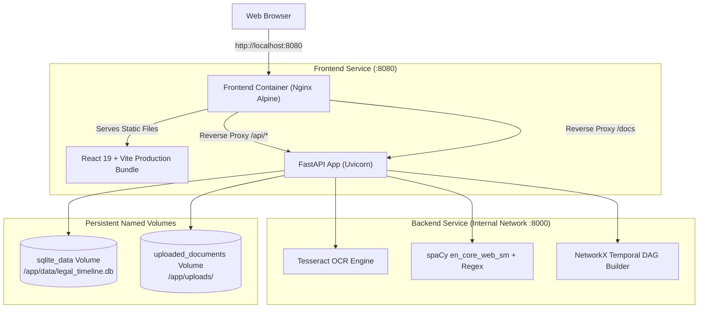

# ⚖️ Simple Legal AI

> **Automatic Legal Timeline Construction and Visualization using Temporal Event Graphs**

[](https://www.python.org/)
[](https://fastapi.tiangolo.com/)
[](https://react.dev/)
[](https://www.typescriptlang.org/)
[](https://vitejs.dev/)
[](https://tailwindcss.com/)
[](LICENSE)

**Simple Legal AI** transforms lengthy, unstructured legal judgments (Indian High Court & Supreme Court style) into structured, chronologically ordered **Temporal Event Graphs**. It extracts legal actors, procedural events, and absolute/relative dates, computes relationship graphs, and visualizes them on an interactive dual-view dashboard.

---

## 📑 Table of Contents

- [Overview](#-overview)
- [Key Features](#-key-features)
- [System Architecture](#-system-architecture)
- [Tech Stack](#-tech-stack)
- [Prerequisites](#-prerequisites)
- [Installation & Quick Start](#-installation--quick-start)
  - [1. Clone the Repository](#1-clone-the-repository)
  - [2. Backend Setup](#2-backend-setup)
  - [3. Frontend Setup](#3-frontend-setup)
- [Running the Application](#-running-the-application)
- [Docker Deployment](#-docker-deployment)
  - [Prerequisites](#prerequisites)
  - [Docker Architecture Overview](#docker-architecture-overview)
  - [Quick Start: Build & Run](#quick-start-build--run)
  - [Starting and Stopping Containers](#starting-and-stopping-containers)
  - [Viewing Logs](#viewing-logs)
  - [Rebuilding After Code Changes](#rebuilding-after-code-changes)
  - [Accessing Frontend & API](#accessing-frontend--api)
  - [Persistent Data Storage](#persistent-data-storage)
  - [Troubleshooting & Common Issues](#troubleshooting--common-issues)
- [Running Tests](#-running-tests)
- [API Reference](#-api-reference)
- [Environment Variables](#-environment-variables)
- [Project Directory Structure](#-project-directory-structure)

---

## 🔍 Overview

Legal judgment texts are inherently long, non-linear, and dense. Critical procedural events (e.g., FIR filing, arrests, remand orders, bail hearings, appeals) are frequently described out of chronological sequence, mixed with relative temporal markers like *"three weeks later"*, *"the following month"*, or *"thereafter"*.

**Simple Legal AI** solves this problem by:
1. Ingesting judgments from PDFs (with OCR for scanned documents), JSON, TXT, or direct text input.
2. Parsing document metadata (court name, citation, bench judges, petitioner, respondent, acts, sections).
3. Extracting legally significant events and dates using a **hybrid NLP pipeline** (Google Gemini AI with rule-based spaCy/regex fallback).
4. Resolving relative time offsets and anchoring events into a mathematically sound **Directed Acyclic Graph (DAG)** of temporal relations (`BEFORE`, `AFTER`, `SIMULTANEOUS`, `OVERLAPS`).
5. Presenting an interactive visual canvas with chronological timeline progression, category tagging, search highlighting, and duration calculations.

---

## ✨ Key Features

- **📄 Multi-Format Ingestion & OCR**:
  - Ingest PDF, TXT, or JSON judgments.
  - Multi-tier PDF parsing (PyMuPDF, pdfplumber, pypdf, pdfminer.six).
  - Built-in OCR fallback using Tesseract for scanned image PDFs.
- **🏷️ Automated Metadata Extraction**:
  - Extracts case citation, court name, bench, petitioner, respondent, judgment date, case numbers, acts, articles, and sections.
- **🧠 Hybrid Temporal NLP Engine**:
  - **Google Gemini API** (`gemini-2.5-flash`) for structured JSON event extraction and legal classification.
  - **Offline Fallback Engine** using spaCy (`en_core_web_sm`), regex date parsers, and custom lemma dictionaries — runs without any API key or GPU!
  - Normalizes dates into ISO-8601 (`YYYY-MM-DD`) via `dateparser`.
- **🕸️ Temporal Event Graph Construction**:
  - Anchors relative dates (e.g., *"14 days after arrest"*) to preceding absolute events.
  - Builds temporal relationships (`BEFORE`, `AFTER`, `SIMULTANEOUS`, `OVERLAPS`).
  - Graph reduction using `networkx` transitive reduction to eliminate redundant transitivities.
- **📊 Interactive Frontend Visualizer**:
  - **Network Graph Canvas**: Interactive force-directed/DAG canvas with pan, zoom, and node selection.
  - **Chronological Timeline View**: Ordered event stream with calculated elapsed durations between steps (e.g., *"+ 2 months 14 days"*).
  - **Event Importance Scoring**: Classifies events as *Critical*, *High*, *Medium*, or *Low* priority.
  - **Category Filtering & Search**: Filter by legal categories (*Arrest*, *Custody*, *FIR*, *Bail*, *Trial*, *Judgment*) with keyword highlighting.
  - **Dual Themes**: *Midnight* (dark mode) and *Parchment* (light editorial mode).
- **⚡ Asynchronous FastAPI Backend**:
  - Background task worker for non-blocking document analysis.
  - Automatic database seeding with realistic Indian High Court mock judgments on first launch.

---

## 🏛️ System Architecture



---

## 💻 Tech Stack

| Domain | Technologies |
|---|---|
| **Backend Framework** | [FastAPI](https://fastapi.tiangolo.com/), [Uvicorn](https://www.uvicorn.org/), Python 3.10+ |
| **Database & ORM** | [SQLAlchemy 2.0](https://www.sqlalchemy.org/), [SQLite](https://sqlite.org/) (dev) / [PostgreSQL](https://www.postgresql.org/) (prod), [Alembic](https://alembic.sqlalchemy.org/) |
| **NLP & AI** | [Google Generative AI (Gemini)](https://ai.google.dev/), [spaCy](https://spacy.io/) (`en_core_web_sm`), [dateparser](https://dateparser.readthedocs.io/) |
| **Document OCR** | [PyMuPDF](https://pymupdf.readthedocs.io/), [pdfplumber](https://github.com/jsvine/pdfplumber), [pytesseract](https://pypi.org/project/pytesseract/), [Pillow](https://python-pillow.org/) |
| **Graph Modeling** | [NetworkX](https://networkx.org/) |
| **Frontend Framework** | [React 19](https://react.dev/), [TypeScript](https://www.typescriptlang.org/), [Vite 8](https://vitejs.dev/) |
| **Styling & UI** | [Tailwind CSS 3.4](https://tailwindcss.com/), [Lucide React](https://lucide.dev/), HTML5 Canvas |
| **Testing** | [pytest](https://pytest.org/), [pytest-cov](https://pytest-cov.readthedocs.io/) |

---

## ⚙️ Prerequisites

Before you begin, ensure you have installed:
1. **Python 3.10 or higher** ([Download Python](https://www.python.org/downloads/))
2. **Node.js 18 or higher & npm** ([Download Node.js](https://nodejs.org/))
3. *(Optional)* **Tesseract OCR** — only needed if you plan to parse scanned image PDFs:
   - **Windows**: `winget install tesseract-ocr.tesseract` (or download from [UB-Mannheim](https://github.com/UB-Mannheim/tesseract/wiki))
   - **macOS**: `brew install tesseract`
   - **Ubuntu/Debian**: `sudo apt install tesseract-ocr`
4. *(Optional)* **Google Gemini API Key** — if you want LLM structured extraction ([Get a Gemini API Key](https://aistudio.google.com/)). The project works completely offline without it.

---

## 🚀 Installation & Quick Start

### 1. Clone the Repository

```bash
git clone https://github.com/ynitishreddy/simple_legal_ai.git
cd simple_legal_ai
```

---

### 2. Backend Setup

Open a terminal and navigate to the `backend/` directory:

```bash
cd backend
```

#### Step 2.1: Create and Activate a Virtual Environment

**Windows (PowerShell or Command Prompt):**
```powershell
python -m venv venv
.\venv\Scripts\activate
```

**macOS / Linux:**
```bash
python3 -m venv venv
source venv/bin/activate
```

#### Step 2.2: Install Backend Dependencies

```bash
pip install -r requirements.txt
```

#### Step 2.3: Download the spaCy English Model

```bash
python -m spacy download en_core_web_sm
```

#### Step 2.4: Configure Environment Variables

Copy the example environment configuration:

**Windows:**
```powershell
copy .env.example .env
```

**macOS / Linux:**
```bash
cp .env.example .env
```

*(Optional)* Open `.env` in a text editor to set your `GEMINI_API_KEY`:
```env
# Optional: Set your Gemini API key for structured extraction
GEMINI_API_KEY=your_gemini_api_key_here

# Default local SQLite database (created automatically)
DATABASE_URL=sqlite:///./legal_timeline.db
```

#### Step 2.5: Initialize the Database

Run the database provisioning script to create all schema tables:

```bash
python init_db.py
```

---

### 3. Frontend Setup

Open a **separate terminal window** and navigate to the `frontend/` directory:

```bash
cd frontend
```

#### Step 3.1: Install Node Dependencies

```bash
npm install
```

---

## 🏃 Running the Application

### 1. Start the Backend API Server

In your backend terminal (with the virtual environment active):

```bash
cd backend
uvicorn main:app --reload --port 8000
```

- **Backend API**: `http://localhost:8000`
- **Interactive API Docs (Swagger UI)**: `http://localhost:8000/docs`
- *Note:* On first boot, the server automatically seeds 3 realistic sample judgments into the database in the background.

### 2. Start the Frontend Development Server

In your frontend terminal:

```bash
cd frontend
npm run dev
```

- Open your browser at **`http://localhost:5173`**
- The Vite dev server automatically proxies API requests from `/api/*` to `http://localhost:8000`.

---

## 🐳 Docker Deployment

The entire Simple Legal AI application is fully containerized using **Docker** and **Docker Compose**, providing a single-command setup with zero manual environment configuration.

### Prerequisites

1. **Docker Desktop** (version 24.0+ recommended) or **Docker Engine & Docker Compose v2**:
   - [Install Docker Desktop for Windows](https://docs.docker.com/desktop/install/windows-install/) (requires WSL 2)
   - [Install Docker Desktop for Mac](https://docs.docker.com/desktop/install/mac-install/)
   - [Install Docker on Linux](https://docs.docker.com/engine/install/)
2. Ensure the Docker daemon is running:
   ```bash
   docker --version
   docker compose version
   ```

### Docker Architecture Overview



- **Backend Container**:
  - Base Image: `python:3.11-slim`
  - Linux Packages: `tesseract-ocr`, `tesseract-ocr-eng` (for scanned PDF OCR fallback) and `curl`
  - Pre-installed spaCy English model (`en_core_web_sm`)
  - Automated schema initialization via `docker-entrypoint.sh`
  - Runs FastAPI on Uvicorn bound to `0.0.0.0:8000`
  - Only exposed to internal Docker bridge network (`simple_legal_ai_network`), keeping API protected
- **Frontend Container**:
  - Multi-stage build (`node:20-alpine` builder → `nginx:alpine` runner)
  - Serves compiled React 19 production build with Gzip compression and client-side SPA routing (`try_files $uri $uri/ /index.html`)
  - Configured with reverse proxy rules forwarding `/api/*` and `/docs` directly to the backend
  - Configured with `client_max_body_size 50M` and 300s timeout to support large multi-page legal document uploads and OCR processing
  - Exposed publicly on **`http://localhost:8080`**
- **Persistent Storage**:
  - `simple_legal_ai_sqlite_data`: Mounts to `/app/data` to persist `legal_timeline.db`
  - `simple_legal_ai_uploaded_documents`: Mounts to `/app/uploads` to persist uploaded documents

---

### Quick Start: Build & Run

From the root of the repository:

**PowerShell / Command Prompt / Bash:**
```bash
# 1. Build container images and start services in detached mode
docker compose up -d --build
```

Docker Compose will build both images, initialize database tables, seed sample cases if the database is fresh, and start services.

---

### Starting and Stopping Containers

```bash
# Start existing containers in detached mode:
docker compose up -d

# Stop running containers (preserves volume data):
docker compose down

# Stop containers AND delete persistent volumes (warning: wipes database):
docker compose down -v
```

---

### Viewing Logs

```bash
# Stream aggregated logs from all services:
docker compose logs -f

# View only backend logs:
docker compose logs -f backend

# View only frontend (Nginx) logs:
docker compose logs -f frontend

# View the last 100 log lines:
docker compose logs --tail=100 backend
```

---

### Rebuilding After Code Changes

Whenever you modify Python backend code, frontend React components, or dependency files:

```bash
# Rebuild images without cache and restart services:
docker compose up -d --build

# Or rebuild a specific service:
docker compose build backend
docker compose up -d backend
```

---

### Accessing Frontend & API

Once running, access the services using your browser:

- **Frontend Web Application**: [http://localhost:8080](http://localhost:8080)
- **Interactive REST API Documentation (Swagger UI)**: [http://localhost:8080/docs](http://localhost:8080/docs)
- **Alternative ReDoc API Documentation**: [http://localhost:8080/redoc](http://localhost:8080/redoc)
- **Backend Health Check**: [http://localhost:8080/api/cases](http://localhost:8080/api/cases)

---

### Persistent Data Storage

Data persistence is handled by Docker named volumes defined in `docker-compose.yml`:

| Volume Name | Container Mount | Description |
|---|---|---|
| `simple_legal_ai_sqlite_data` | `/app/data` | Stores SQLite database (`legal_timeline.db`). Preserves ingested cases, extracted events, and temporal edges across restarts. |
| `simple_legal_ai_uploaded_documents` | `/app/uploads` | Stores uploaded PDF/TXT/JSON files for permanent record retention. |

To inspect stored volumes:
```bash
docker volume ls
docker volume inspect simple_legal_ai_sqlite_data
```

To backup the SQLite database from the volume:
```bash
docker compose cp backend:/app/data/legal_timeline.db ./backup_legal_timeline.db
```

---

### Troubleshooting & Common Issues

#### 1. Port 8080 Already in Use
If port 8080 is already occupied by another application, open `docker-compose.yml` and modify the frontend port mapping:
```yaml
ports:
  - "8081:80"  # Changes external port to 8081
```

#### 2. Container Healthcheck Failing
Check the exact container status:
```bash
docker compose ps
docker compose logs backend
```
The frontend service waits for the backend to pass its health check (`/` returning HTTP 200). On initial startup, backend initialization and spaCy model loading takes approximately 10-20 seconds.

#### 3. Uploaded Scanned PDFs Not Producing Text
Verify that Tesseract OCR is available inside the backend container:
```bash
docker compose exec backend tesseract --version
```
The Dockerfile installs `tesseract-ocr` and `tesseract-ocr-eng` automatically.

#### 4. Resetting to Fresh Database
To clear all data and have the backend re-seed the initial sample judgments:
```bash
docker compose down -v
docker compose up -d
```

---

## 🧪 Running Tests

The test suite covers schema validation, database CRUD, mock S3 ingestion, regex/LLM NLP extraction, date normalization, graph construction, and FastAPI REST endpoints.

Run tests from the repository root or `backend/` directory:

```bash
# Run all 81 backend tests with verbose output
pytest backend/tests/ -v

# Run with test coverage report
pytest backend/tests/ --cov=. -v
```

You can also run the standalone end-to-end pipeline verification script:

```bash
python backend/run_graph_test.py
```

To run frontend linting or build validation:

```bash
cd frontend
npm run lint
npm run build
```

---

## 📡 API Reference

The backend exposes an asynchronous REST API documented interactively at `http://localhost:8000/docs`.

| Method | Endpoint | Description |
|---|---|---|
| `GET` | `/` | API health status and documentation link |
| `POST` | `/api/cases/analyze-file` | Parses uploaded document (PDF/TXT/JSON), performs OCR check, extracts metadata, and returns preview |
| `POST` | `/api/cases/upload` | Ingests a judgment (file upload or raw text) and triggers asynchronous background timeline pipeline |
| `GET` | `/api/cases` | Retrieves a paginated list of all ingested cases |
| `GET` | `/api/cases/{case_id}/status` | Checks background pipeline processing progress and status |
| `GET` | `/api/cases/{case_id}/timeline` | Returns visualizer-ready graph nodes, edges, relations, and case metadata |

---

## 🔧 Environment Variables

All settings can be specified via `backend/.env` or system environment variables:

| Variable | Default | Description |
|---|---|---|
| `DATABASE_URL` | `sqlite:///./legal_timeline.db` | SQLAlchemy connection string (SQLite for dev, PostgreSQL for prod) |
| `GEMINI_API_KEY` | `""` | *(Optional)* Google Gemini API key for structured event extraction |
| `APP_ENV` | `development` | Deployment environment (`development` or `production`) |
| `LOG_LEVEL` | `INFO` | Python logging level (`DEBUG`, `INFO`, `WARNING`, `ERROR`) |
| `AWS_ACCESS_KEY_ID` | `""` | *(Optional)* AWS Access Key if streaming judgments from real S3 |
| `AWS_SECRET_ACCESS_KEY` | `""` | *(Optional)* AWS Secret Access Key |
| `AWS_REGION` | `ap-south-1` | AWS S3 bucket region |
| `S3_BUCKET` | `indian-high-court-judgments` | AWS S3 bucket name |
| `S3_PREFIX` | `raw/` | S3 key prefix for judgment objects |

---

## 📁 Project Directory Structure

```
simple_legal_ai/
├── README.md                          # Root project documentation (this file)
├── docker-compose.yml                 # Multi-container orchestration (Frontend + Backend)
│
├── backend/                           # FastAPI + NLP + Graph backend
│   ├── Dockerfile                     # Python 3.11 + Tesseract OCR + spaCy production image
│   ├── .dockerignore                  # Build context exclusions (venv, db, cache)
│   ├── docker-entrypoint.sh           # DB schema initialization & startup script
│   ├── README.md                      # Backend technical architecture & guide
│   ├── main.py                        # FastAPI entry point & lifespan manager
│   ├── config.py                      # Pydantic application settings
│   ├── init_db.py                     # Database schema provisioning script
│   ├── run_graph_test.py              # End-to-end pipeline test script
│   ├── requirements.txt               # Python package dependencies
│   ├── pyproject.toml                 # uv/hatch project manifest
│   ├── .env.example                   # Environment variable template
│   │
│   ├── api/                           # REST API routes
│   │   └── routes.py                  # Case upload, file analysis & timeline endpoints
│   │
│   ├── db/                            # Database layer
│   │   ├── base.py                    # Engine, sessionmaker & declarative base
│   │   ├── models.py                  # Case, Event & TemporalRelation ORM models
│   │   └── seed.py                    # Automatic database seeding routine
│   │
│   ├── nlp/                           # NLP & temporal extraction
│   │   ├── extractor.py               # Gemini LLM + spaCy / regex hybrid extractor
│   │   ├── metadata_extractor.py      # Case metadata (court, bench, acts) extractor
│   │   ├── pdf_parser.py              # Multi-engine PDF reader & Tesseract OCR fallback
│   │   ├── pipeline.py                # End-to-end ingestion-to-graph pipeline
│   │   └── schemas.py                 # Pydantic schemas for LLM structured output
│   │
│   ├── graph/                         # Graph construction
│   │   └── builder.py                 # NetworkX DAG builder, anchor resolver & transitive reduction
│   │
│   ├── ingestion/                     # Ingestion & data loading
│   │   ├── s3_streamer.py             # S3 streamer with local mock fallback
│   │   └── mock_data/                 # Sample Indian legal judgments
│   │       └── judgments.json
│   │
│   └── tests/                         # Comprehensive test suite (81 tests)
│       ├── test_schema.py             # Schema & CRUD tests
│       ├── test_ingestion.py          # S3 streamer & text cleaning tests
│       ├── test_nlp.py                # NLP extraction & date parsing tests
│       ├── test_graph.py              # Relative time offsets & DAG reduction tests
│       └── test_api.py                # FastAPI endpoint integration tests
│
└── frontend/                          # React + TypeScript + Vite UI
    ├── Dockerfile                     # Multi-stage build (Node 20 build -> Nginx Alpine)
    ├── .dockerignore                  # Build context exclusions (node_modules, dist)
    ├── nginx.conf                     # Nginx configuration (SPA routing & API reverse proxy)
    ├── README.md                      # Frontend-specific documentation
    ├── package.json                   # npm dependencies and scripts
    ├── vite.config.ts                 # Vite config with backend proxy (/api)
    ├── tailwind.config.js             # Tailwind CSS design system config
    ├── index.html                     # HTML root template
    └── src/
        ├── App.tsx                    # Main legal dashboard & timeline controller
        ├── components/
        │   └── NetworkGraphCanvas.tsx # Interactive HTML5 Canvas DAG visualizer
        └── index.css                  # Global styles & theme tokens
```

---

## 📄 License

This project is open-source and available under the [MIT License](LICENSE).
