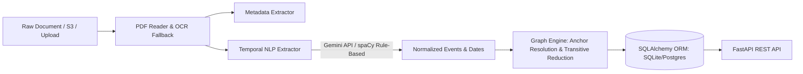

# ⚖️ Simple Legal AI — Backend Service

> **FastAPI REST Service, Temporal NLP Entity Extraction, and Event Graph Engine**

The backend service for **Simple Legal AI** ingests legal judgment texts, extracts temporal events and legal metadata, computes a Directed Acyclic Graph (DAG) of temporal relationships, and exposes an asynchronous REST API for the visualization client.

---

## 📑 Table of Contents

- [Architecture Overview](#-architecture-overview)
- [Directory Layout](#-directory-layout)
- [Prerequisites](#-prerequisites)
- [Quick Start & Installation](#-quick-start--installation)
- [Running the Backend](#-running-the-backend)
- [Environment Configuration](#-environment-configuration)
- [Data Model & Database Schema](#-data-model--database-schema)
- [Core Pipelines](#-core-pipelines)
  - [1. Ingestion & Document Parsing](#1-ingestion--document-parsing)
  - [2. Metadata Extraction](#2-metadata-extraction)
  - [3. Temporal Event Extraction (Hybrid NLP / LLM)](#3-temporal-event-extraction-hybrid-nlp--llm)
  - [4. Temporal Graph Builder (NetworkX)](#4-temporal-graph-builder-networkx)
- [API Reference](#-api-reference)
- [Running Tests](#-running-tests)

---

## 🏛️ Architecture Overview

The backend is built around a multi-stage pipeline:



1. **Document Ingestion**: Supports direct text, `.txt`, `.json`, and `.pdf` uploads. Multi-engine PDF parser (PyMuPDF, pdfplumber, pypdf, pdfminer.six) with automatic scanned document detection and Tesseract OCR fallback.
2. **Metadata Extraction**: Discovers court name, citation, judges/bench, petitioner, respondent, judgment date, and statutory references (Acts, Articles, Sections).
3. **Temporal NLP Extraction**: Uses Google Gemini API (`gemini-2.5-flash`) for structured JSON extraction. Automatically falls back to a deterministic rule-based spaCy (`en_core_web_sm`) and regex parser if the Gemini API key is not configured or network is unavailable.
4. **Graph Construction**: Normalizes dates with `dateparser` into ISO-8601, resolves relative markers (e.g. *"two weeks later"*), and uses `networkx` to build a temporal DAG with transitive reduction.
5. **Database Storage & REST API**: SQLAlchemy 2.0 ORM with asynchronous FastAPI endpoints and background task processing.

---

## 📁 Directory Layout

```
backend/
├── config.py                     # Centralized Pydantic application settings
├── init_db.py                    # Database schema creation / reset script
├── main.py                       # FastAPI entrypoint, lifespan, CORS, and seeding
├── pyproject.toml                # uv / hatch build manifest
├── requirements.txt              # Production and development pip dependencies
├── run_graph_test.py             # Standalone end-to-end pipeline verification script
├── .env.example                  # Environment configuration template
│
├── api/
│   └── routes.py                 # FastAPI router (/api/cases/* endpoints)
│
├── db/
│   ├── base.py                   # SQLAlchemy engine, session factory, Base
│   ├── models.py                 # Case, Event, TemporalRelation ORM entities
│   └── seed.py                   # Auto-seeding routine (loads 3 sample cases on startup)
│
├── ingestion/
│   ├── s3_streamer.py            # S3 reader with local mock fallback
│   └── mock_data/
│       └── judgments.json        # Realistic Indian High Court judgment corpus
│
├── nlp/
│   ├── extractor.py              # Hybrid LLM (Gemini) + spaCy/regex event extractor
│   ├── metadata_extractor.py     # Legal metadata regex & heuristic parser
│   ├── pdf_parser.py             # Multi-engine PDF extractor with Tesseract OCR fallback
│   ├── pipeline.py               # Batch processor coordinating DB -> NLP -> Graph
│   └── schemas.py                # Pydantic schemas for LLM structured output
│
├── graph/
│   └── builder.py                # NetworkX graph builder, anchor resolution & reduction
│
└── tests/
    ├── conftest.py               # Pytest fixtures and mock setups
    ├── test_api.py               # REST API endpoint tests
    ├── test_graph.py             # Relative time calculation and graph reduction tests
    ├── test_ingestion.py         # Text cleaning and ingestion tests
    ├── test_nlp.py               # Event extraction, regex and date normalization tests
    └── test_schema.py            # Database schema integrity and CRUD tests
```

---

## ⚙️ Prerequisites

- **Python 3.10+**
- *(Optional)* **Tesseract OCR** — required only for scanned image PDFs:
  - Windows: `winget install tesseract-ocr.tesseract` (default path: `C:\Program Files\Tesseract-OCR\tesseract.exe`)
  - Linux: `sudo apt install tesseract-ocr`
  - macOS: `brew install tesseract`
- *(Optional)* **Google Gemini API Key** — required only for LLM structured event extraction. If omitted, the engine uses the built-in rule-based spaCy extractor.

---

## 🚀 Quick Start & Installation

### 1. Set up Virtual Environment

**Windows:**
```powershell
cd backend
python -m venv .venv
.\.venv\Scripts\activate
```

**Linux / macOS:**
```bash
cd backend
python3 -m venv .venv
source .venv/bin/activate
```

### 2. Install Dependencies

```bash
pip install -r requirements.txt
```

### 3. Download the spaCy Model

```bash
python -m spacy download en_core_web_sm
```

### 4. Configure Environment Variables

```bash
# Windows
copy .env.example .env

# Linux / macOS
cp .env.example .env
```

Edit `.env` to configure your settings (see [Environment Configuration](#-environment-configuration)).

### 5. Initialize Database Schema

```bash
python init_db.py
```

To drop and recreate tables from scratch during development:
```bash
python init_db.py --drop-all
```

---

## 🏃 Running the Backend

Launch the Uvicorn ASGI server with live reloading:

```bash
uvicorn main:app --reload --port 8000
```

- **API Base URL**: `http://localhost:8000`
- **Interactive OpenAPI Documentation**: `http://localhost:8000/docs`
- **Alternative ReDoc Documentation**: `http://localhost:8000/redoc`

> **Note on Auto-Seeding**: When the server boots up, it checks if the database is empty. If no cases exist, it spawns a background thread that automatically loads and processes 3 sample Indian High Court cases from `ingestion/mock_data/judgments.json`.

---

## 🔧 Environment Configuration

| Variable | Default | Description |
|---|---|---|
| `DATABASE_URL` | `sqlite:///./legal_timeline.db` | SQLAlchemy DSN (SQLite for development, PostgreSQL for production) |
| `GEMINI_API_KEY` | `""` | *(Optional)* Gemini API Key for structured event extraction |
| `APP_ENV` | `development` | Deployment environment (`development` / `production`) |
| `LOG_LEVEL` | `INFO` | Logging level (`DEBUG`, `INFO`, `WARNING`, `ERROR`) |
| `AWS_ACCESS_KEY_ID` | `""` | *(Optional)* AWS credentials for live S3 ingestion |
| `AWS_SECRET_ACCESS_KEY` | `""` | *(Optional)* AWS credentials for live S3 ingestion |
| `AWS_REGION` | `ap-south-1` | AWS S3 region |
| `S3_BUCKET` | `indian-high-court-judgments` | S3 bucket name |
| `S3_PREFIX` | `raw/` | S3 key prefix for judgment objects |

---

## 🗄️ Data Model & Database Schema

```
┌────────────────┐          ┌────────────────┐          ┌────────────────────┐
│      Case      │ 1      * │     Event      │ 1      * │  TemporalRelation  │
├────────────────┼──────────┼────────────────┼──────────┼────────────────────┤
│ id (UUID)      │          │ id (UUID)      │          │ id (UUID)          │
│ case_citation  │          │ case_id (FK)   │          │ case_id (FK)       │
│ court_name     │          │ trigger_word   │          │ source_event_id(FK)│
│ raw_text       │          │ description    │          │ target_event_id(FK)│
│ petitioner     │          │ abs_date_iso   │          │ relation_type      │
│ respondent     │          │ sentence_idx   │          │ (BEFORE, AFTER,    │
│ judges         │          │ category       │          │  SIMULTANEOUS,     │
│ acts, sections │          │ actor          │          │  OVERLAPS)         │
│ status         │          │ confidence     │          └────────────────────┘
└────────────────┘          └────────────────┘
```

### Enums
- **`CaseStatus`**: `PENDING` → `PROCESSING` → `COMPLETED` (or `FAILED`)
- **`RelationType`**: `BEFORE`, `AFTER`, `SIMULTANEOUS`, `OVERLAPS`

---

## ⚙️ Core Pipelines

### 1. Ingestion & Document Parsing (`nlp/pdf_parser.py` & `ingestion/s3_streamer.py`)
- Reads raw text or binary PDF streams.
- PDF engine cascades: **PyMuPDF (`fitz`)** → **pdfplumber** → **pypdf** → **pdfminer.six**.
- If character density is low (< 30 chars/page), it flags the document as scanned and runs **Tesseract OCR** at 150 DPI.
- S3 streamer ingests from AWS S3 or falls back to local `judgments.json`.

### 2. Metadata Extraction (`nlp/metadata_extractor.py`)
- Regular expression and heuristic parsing for:
  - Case citations (e.g., `(2023) 4 SCC 120`, `2024 INSC 45`)
  - Bench judges (e.g., *Hon'ble Mr. Justice...*)
  - Parties: Petitioner vs. Respondent
  - Statutory mentions (IPC, CrPC, CPC, Constitution articles)

### 3. Temporal Event Extraction (`nlp/extractor.py`)
- **Primary LLM Strategy**: Uses Google Gemini 2.5 Flash with Pydantic JSON schema enforcement (`LegalEventsExtractionPayload`).
- **Deterministic Fallback**: If Gemini is not configured, spaCy extracts sentences, matches legal event lemma triggers (`arrest`, `charge`, `bail`, `remand`, `convict`, `acquit`, `petition`, `order`), identifies absolute dates and relative markers, and normalizes dates to ISO-8601.

### 4. Temporal Graph Builder (`graph/builder.py`)
- Anchors relative dates (e.g., *"10 days later"*) to preceding absolute event timestamps.
- Constructs a directed graph in `NetworkX`.
- Detects chronological orders and applies **transitive reduction** to eliminate redundant shortcuts while preserving temporal dependencies.

---

## 📡 API Reference

Interactive Swagger documentation is available at `http://localhost:8000/docs`.

### Key Endpoints

#### 1. Ingest Case
`POST /api/cases/upload`
- Accepts multipart file upload (PDF/TXT/JSON) or form fields (`raw_text`, `case_citation`, `court_name`).
- Creates a `Case` record with `PENDING` status.
- Triggers background NLP & graph pipeline.
- Returns: `{"case_id": "uuid"}`.

#### 2. Analyze File (Pre-upload Preview)
`POST /api/cases/analyze-file`
- Accepts multipart file upload.
- Runs text extraction (with OCR check) and metadata extraction.
- Returns:
  ```json
  {
    "file_name": "judgment.pdf",
    "file_size": 1048576,
    "page_count": 12,
    "ocr_run": false,
    "extracted_text": "...",
    "metadata": {
      "citation": "2024 INSC 12",
      "court_name": "Supreme Court of India",
      "petitioner": "State of Maharashtra",
      "respondent": "A. K. Sharma",
      "judges": "Hon'ble Dr. Justice D. Y. Chandrachud",
      "judgment_date": "2024-03-15"
    }
  }
  ```

#### 3. List Ingested Cases
`GET /api/cases?skip=0&limit=10`
- Returns paginated list of cases with statuses and citations.

#### 4. Case Processing Status
`GET /api/cases/{case_id}/status`
- Returns current pipeline state: `PENDING`, `PROCESSING`, `COMPLETED`, or `FAILED` along with progress step description.

#### 5. Case Timeline & Graph Query
`GET /api/cases/{case_id}/timeline`
- Returns nodes (events) and edges (relations) formatted for frontend graph visualizers:
  ```json
  {
    "case_info": { "id": "...", "citation": "...", "court": "..." },
    "nodes": [
      {
        "id": "event-uuid",
        "label": "arrest",
        "title": "Accused was arrested on 14th August 2023",
        "start": "2023-08-14",
        "category": "Criminal",
        "actor": "Police",
        "sentence_index": 2
      }
    ],
    "edges": [
      {
        "id": "rel-uuid",
        "from": "event-uuid-1",
        "to": "event-uuid-2",
        "label": "BEFORE"
      }
    ]
  }
  ```

---

## 🧪 Running Tests

The test suite contains 81 comprehensive unit and integration tests.

```bash
# Run full test suite
pytest tests/ -v

# Run a specific test module
pytest tests/test_api.py -v
pytest tests/test_nlp.py -v
pytest tests/test_graph.py -v

# Run with test coverage
pytest tests/ --cov=. -v
```

### Standalone Pipeline Verification Script

You can also run the self-contained pipeline test script:

```bash
python run_graph_test.py
```
